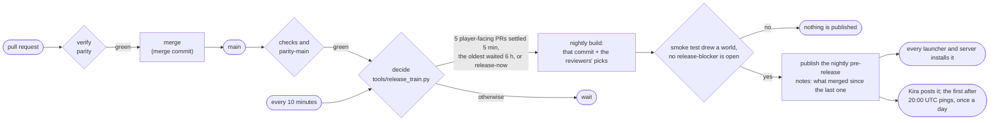

# Release flow

How a change gets from a pull request to players: the checks a pull request passes, how it merges, and the
automatic releases that follow. Releases are automatic and frequent so the latest Horizon is always playable.
Since 2026-10-28 Horizon ships only the **Nightly** (Ludovic's decision; the Team proposed it): the batch train builds
a Nightly instead of a `vX.Y.Z` release, it is published once its smoke test passed and no `release-blocker` is open,
and every launcher and `horizon-server update` install it ([Nightly only](#nightly-only)).

## Pull request checks

The `checks` workflow (`.github/workflows/ci.yml`) runs two jobs on every pull request (opened, pushed to or
reopened; labels never start it):

| Job | Runs on | What | Time |
| --- | --- | --- | --- |
| `verify` | GitHub `ubuntu-latest` | Public-tree check, Python tests, rustfmt, clippy with warnings denied, Rust tests. Dependencies and the workspace build come from a cache saved by main's runs | ~4 min cold, less warm |
| `parity / parity` | A runner with the label `horizon-game`: the Mac mini's and playhorizon's (below) | Only for a change to a harness, an oracle, a probe or the runner (or the `run-parity` label): the vanilla harnesses the change can affect (`tools/parity.py --changed <base>`). Other pull requests skip it: [parity-main](#parity-on-main) checks them on main | seconds when nothing is affected; minutes per affected harness |

Pushes to main run `verify` only; the nightly audit covers main's harnesses.

`verify` is the check main requires, so it has no condition and runs in every run of `checks`: GitHub counts a
*skipped* required check as passed, and labels used to start runs whose `verify` was skipped, which let
auto-merge merge before the real `verify` finished. A pull request that changes no Rust (docs, tools) runs only its
quick steps and finishes in seconds.

### The parity job

The job is `.github/workflows/parity.yml`, a reusable workflow: `checks` calls it for pull requests from this
repository, `run-parity.yml` for a fork's pull request a maintainer labels `run-parity`.

A pull request every harness reaches (a crate split moves files every probe links: #2160 ran all 352 harnesses, 71
minutes on a Mac mini runner, while five other pull requests' jobs queued behind it) carries the `full-parity` label:
its job runs on playhorizon's runner only (4 harnesses at a time), and waits for it while that runner is busy
instead of taking the Mac mini's. Labels don't start `checks`: add it when opening the pull request
(`gh pr create --label full-parity`), or before the next push.

Horizon never downloads the game, so harnesses that compare with vanilla run only where the maintainer's own
copy is: the Mac mini and playhorizon (below). Their runners run as the maintainer's account and keep their checkout
between runs (`clean: false`), so the probes build incrementally into `.local/parity-target` and earlier passes
stand.

The job tests the pull request's head merged into main's current tip, which is what merging it would land: harness
and game fixes that reached main after the branch was made apply to it too, and an old branch runs main's runner
scripts and selection unless it changes them. The base for the selection is that main commit, so only the pull
request's own changes count. The job summary names the main commit. A head that conflicts with main is tested
alone, with a warning. The check is still reported on the head.

1. `tools/ci/runner-env.sh` puts the machine's Python 3.13 and the JDK `research-lock.json` pins on the PATH
   (Homebrew and `java_home` on the Mac; on Linux what `linux-runner.sh` pinned, else nixpkgs), and sccache when
   the machine has it.
2. `tools/ci/vanilla-data.sh` links `.local/` to the runner's copy of the vanilla data, cloned once from
   `~/code/horizon-parity/shared-local` into `~/.actions-runners/horizon/_work/horizon/shared-local`, and
   prepares `.local/horizon-client` with the pull request's own `horizon-prepare` once per preparer version
   (its sources, the exporters in `mods/horizon/src/test/java` and `research-lock.json`). The game's sounds, which
   depend only on the Minecraft version, are kept once in `shared-local/sounds/<version>/` (copied from a folder
   `horizon-prepare sounds` made from the maintainer's own game; the Mac mini has no official launcher of its own)
   and cloned into each preparation (not linked: vanilla's packs refuse symbolic links), for the audio harnesses.
   `tools/prepare_output.py check` then compares what was prepared with `crates/horizon-prepare/output-versions.txt`:
   launchers keep a player's prepared resources across releases whose preparer declares the same `OUTPUT_VERSION`
   (`crates/horizon-prepare/src/lib.rs`), so a change to the prepared files fails here until it bumps the number
   and appends the new digest (the error gives both lines).
3. `tools/parity.py --changed <base sha>` picks the harnesses whose traced dependencies (their script, Python
   modules, Java oracles and every Rust source their probes compile) changed since the merge base, plus any
   harness nothing is recorded about yet, and runs those that have no pass for their current inputs. A change to
   `Cargo.lock` or `research-lock.json` affects every harness. Each harness has 25 minutes, the job 45.

Failed harnesses' logs are uploaded as the `parity-logs` artifact.

**Platform-specific harnesses.** A harness listed under `linux_only` in `tools/parity_hosts.json` gives
different results on macOS for a reason that is not a Horizon bug (the reason is printed). `parity.py` skips it on
other platforms unless it is named on the command line. Today it holds only `save_roundtrip` (it needs `vscreen`):
`options`, `chunk_generation`, `world_border_render` and `mob_ai`, which once differed on macOS through the
platform's libm, pass on the Mac mini since `horizon_core::jmath` computes what HotSpot computes (checked
2026-10-14).

**Pull requests from forks** never run code on the Mac mini by themselves. A maintainer who has read the change
adds the `run-parity` label: that runs the job once, on the commit the pull request had then. To run it again
after new pushes, remove the label and add it again.

**Two runners.** The Mac mini has two runners for this repository, `ludovics-mac-mini`
(`~/.actions-runners/horizon`, `CARGO_BUILD_JOBS=10`) and `ludovics-mac-mini-2` (`~/.actions-runners/horizon-2`,
`CARGO_BUILD_JOBS=6`), with the same labels, so the 30-minute nightly audit or a long parity job never holds a
release's macOS build back. Each keeps its own checkout, `target/` and Rust install; the second's
`_work/horizon/shared-local` links to the first's, so they share the vanilla data, the preparations (one at a
time, under a lock) and the parity passes and slots.

**The desktop's runner (retired).** On 2026-10-26 the maintainer asked that CI stop using his desktop: its services are
stopped and `ludodesktop-horizon` has no label a job asks for (only `self-hosted`, `Linux`, `X64`), so nothing waits for
it. What follows describes it as it ran. It ran on the maintainer's Linux desktop while nobody used it: its
screen locked, or untouched for 15 minutes (his rule, 2026-10-26). `tools/ci/linux-runner.sh install`, run there as
him, registers it and installs two systemd user services: `horizon-runner` (the runner, in
`~/.actions-runners/horizon`, nice 19, in `horizon-ci.slice` with CPU and I/O weight 20, half the threads (on all of
them the CPU package reached 92–96 °C) and memory capped at two thirds of the RAM; `CARGO_BUILD_JOBS` and the harness slots at 8, after the machine froze under ~7 cold cargo
builds on 2026-10-14; its own Rust install; the JDK, sccache and the build libraries from nixpkgs; its own
`vscreen` so no game it starts reaches his screen) and `horizon-runner-pause` (`tools/ci/runner_pause.py`), the
only thing that starts the runner. The watcher stops it at once on keyboard, mouse or gamepad input (read from
`/dev/input`: only whether bytes came, never what), while an unlocked session has had input in the last 15 minutes,
while the CPU package is at 90 °C or more, while a game runs (Steam, gamescope, Wine, Proton or Minecraft
processes, fleet-load's own detection, or a process outside the CI slice using the GPU at 50 % or more), or while
`~/.actions-runners/horizon/pause` exists, and starts it again 5 minutes after the last such sign. A job already
under way is throttled to 2 threads at the lowest weight and the runner stops after it: freezing the job would make
GitHub drop it as lost and the harnesses time out. Old pull requests' `runner-env.sh` know only the Mac: the
runner's `.env` and `.path` give their jobs Python, the JDK and the vanilla data (`HORIZON_SHARED_SOURCE`) all the
same. The nightly audit and parity-main stay on the Mac mini's runners: the audit compares with the previous night,
so it stays on one platform, and a parity-main job slowed down on the desktop because he came back could time out,
and its failures bisect and comment on merges.

**playhorizon's runner.** `playhorizon-horizon` runs on a server a hosting partner lends the project (Ubuntu, 8
AMD EPYC threads, 30 GB, in Detroit; reachable only through the maintainer's tailnet). Nobody sits at it, so the
watcher never pauses it except by hand. It gets half the machine: `RUNNER_MEMORY=24`, `CARGO_BUILD_JOBS` and the
harness slots at 4, and a drop-in (`~/.config/systemd/user/horizon-runner.service.d/cpus.conf`) that starts it under
`taskset -c 4-7` (the user slice can't set `AllowedCPUs`: systemd doesn't delegate the cpuset controller to it).
Agents' `tools/remote.sh` runs and benchmarks share CPUs 0-3, so they never slow a pull request's job.
Without Nix, `linux-runner.sh` takes the build libraries, the JDK, sccache, Xvfb and Mesa's software Vulkan
(lavapipe; there is no GPU) from apt, and Python 3.13 from uv. The partner can reach the machine, so gh is not
logged in there: the registration token comes from another machine (`RUNNER_TOKEN`), and no job with secrets may
run there (parity has none). It is also a parity host (`playhorizon` in `tools/parity_hosts.json`, 3 jobs on CPUs 0-3). Since
2026-10-26 it has the `horizon-game` label: pull requests' parity jobs run there or on the Mac mini, and `full-parity`
ones only there.

## Merging

Pull requests merge with a merge commit, by hand: never `gh pr merge --auto`. Branch protection on main
requires `verify` for everyone, and Ludovic's review for the files `.github/CODEOWNERS` lists (what builds, signs
and ships releases). Branches don't have to be up to date with main: main's own `checks` run catches the rare
semantic conflict.

**Who merges.** The Horizon Team (GitHub team `horizon-team`: kacpherek, levzzz5154, rdbtCVS, Online5277) and
Ludovic. The orchestrator's agents prove only the risky pull requests (below), so a contributor's ordinary pull
request doesn't wait for them.

**An ordinary pull request merges on CI.** A Team member:

1. reads the whole diff (for a fork, before adding `run-parity`: that runs the fork's code on a maintainer's machine);
2. adds `run-parity` to a fork's pull request; our own branches run `parity` by themselves. Since #2448 it tests
   the pull request merged into main;
3. merges once `verify` and `parity` pass, nobody's change request is open, and every comment has been read (a
   "don't merge" from anyone holds it).

Never merge your own pull request: another Team member reviews and merges it. Never force-push or rebase a
contributor's branch; push a fixup commit, or merge main into it.

**A risky pull request gets the `needs-proof` label** and waits for an agent's local proof (both single-player
paths, `lan_e2e`, a screenshot for anything visible) before it merges. Risky means any of:

- it changes what is saved or loaded (`save.rs`, `entity_nbt.rs`, `block_entity_nbt.rs`, `region.rs`, `datafix/`):
  a bug there damages players' worlds;
- the network or the server thread: `horizon-protocol`, `net.rs`, `remote*.rs`, `lan/`, `lan*.rs`,
  `integrated.rs`, `levels.rs`, `dedicated*`;
- world generation (`worldgen/`): seeds must keep generating the same terrain;
- the launcher's installs and updates, or the mod runtime;
- the harnesses themselves (`tools/test_*_parity.py`, the Java oracles): a wrong harness hides regressions;
- over ~500 lines, or `parity` failed, was skipped or ran no harness for gameplay code.

Unsure? Add `needs-proof`: it costs a few hours, a broken release costs more.

`parity` becomes required once it has run green on pull requests for a while (a week without a false failure):

```sh
gh api -X POST repos/horizon-rust/horizon/branches/main/protection/required_status_checks/contexts -f 'contexts[]=parity / parity'
```

A skipped `parity` (a fork's pull request without the label) counts as passed, so requiring it never blocks a
fork's pull request: the Team member decides whether to run it, and a skipped run makes the pull request risky.

## Parity on main

Most pull requests merge on `verify` alone and leave the vanilla harnesses to `.github/workflows/parity-main.yml`,
which runs them on main a batch of merges at a time, on the Mac mini's runner:

- It starts on every push to main, one run at a time (`concurrency: parity-main`). Merges that land while a run
  goes on wait in one pending run: GitHub keeps only the newest and cancels the others, so the next run takes them
  all.
- `tools/parity_main.py base` gives the newest commit main contains whose parity-main passed (else the last
  merge's parent), and the run is `tools/parity.py --changed <that commit>`: the union of the harnesses every merge
  since then can affect, once, with every earlier pass reused.
- On a failure, `tools/parity_main.py bisect` checks out the batch's first-parent merges by halves and runs only
  the failing harnesses, names the first merge they fail on in the run's summary and comments on its pull request
  (`🤖 Agent: parity-main found that this merge breaks ...`). Fix it with a pull request as usual; the next
  run checks from the last green commit again.
- Nightlies build only on a commit both `checks` and `parity-main` passed on (`tools/release_train.py`,
  `tools/ci/nightly.py`, see below), so a broken merge holds them instead of reaching players. `release.yml` also
  starts when a parity-main run finishes. A forced run (`force=true`) doesn't wait for parity-main.

A pull request still runs its own parity job when it changes a harness script, an oracle
(`mods/horizon/src/test/`), a probe (`crates/*/examples/`, `game/*_fixture.rs`, `game/*_harness.rs`), the runner
(`tools/parity*.py`, `tools/lab.py`, `tools/parity_hosts.json`, `parity*.yml`), or carries the `run-parity` label
(`run-parity.yml` runs it when the label is added).

## Game releases

`.github/workflows/release.yml` is the batch train: it decides when a new Nightly goes out and starts
`nightly build` (`.github/workflows/nightly-build.yml`, [Nightly channel](#nightly-channel)) on the commit it
decided, which builds, signs and publishes it. It starts after every green `checks` or `parity-main` run of a push to
main, every 10 minutes (so a batch waiting for merges to settle goes out without another merge), and by hand.



### When it releases

`tools/release_train.py decide --kind game` looks at the pull requests merged into main (first-parent merge
commits) since the commit the published Nightly was built on:

- A pull request counts when it changed what players run: `crates/` (not `examples/`, `tests/`, `benches/`),
  `xtask/`, `packaging/`, `Cargo.toml`, `Cargo.lock`, `research-lock.json`, or an exporter `horizon-prepare`
  compiles (the `mods/horizon/src/test/java/dev/horizonlab/parity/*.java` files its sources name). Markdown never
  counts.
- It goes in batches, so players get a few Nightlies a day rather than one per merge: once 5 pull requests count
  and the newest of them merged at least 5 minutes ago (a wave of merges becomes one Nightly), or once the oldest has
  waited 6 hours, however few they are.
- A pull request labelled `release-now` (a crash or a blocker) goes out at once.
- A pull request labelled `skip-release` (work players don't see) doesn't count and isn't listed in the notes.
- An open issue labelled `release-blocker` holds every Nightly, forced ones too (`held by release-blocker #N`);
  `nightly build` checks again right before publishing.
- One Nightly build at a time: while one runs or waits, the train starts none. At most 12 builds a UTC day (the
  reviewers' `/nightly` builds count): past that the train waits for the next day, except for `release-now` and
  `force=true`.
- A scheduled run takes main's newest commit where `checks` and `parity-main` passed; after a run of either, the
  commit it passed on, once both passed there.

### Nightly only

Ludovic decided on 2026-10-28 that Horizon ships only the Nightly. No `vX.Y.Z` game release is made any more:
the last one stays GitHub's *latest*, so launchers and servers from before the switch (which don't read Nightlies)
keep a working build until they update themselves. `.github/release-line.txt` still numbers the launcher's releases
(`launcher@X.Y.Z`).

- **Launchers** (#3342) install the current `nightly` pre-release as their update, as the version
  `nightly-<date>-<commit>`, after checking its checksums signed for the Nightly channel. A player on the newest
  release, on a Nightly or on nothing moves to it at the next check; a version picked by hand or pinned by an
  instance stays. Worlds are in the game's folder, never in a version's, so nothing touches them. The "Nightly
  builds" setting is gone. The last week's Nightlies (`nightly-<date>`) and the old releases stay on the Versions
  page.
- **Servers** (#3331): `horizon-server update`, `install.sh` and `install.ps1` follow the Nightly the same way.
- **Kira** posts each Nightly in #releases; the bug template asks for the version the game shows.
- **Everyone gets the reviewers' picks.** A Nightly is main plus the pull requests the trusted reviewers picked
  ([below](#trusted-reviewers-pick-the-nightlys-pull-requests)), so a pick reaches every player with the next
  Nightly. `/nightly clear` makes it main alone.

### Labels

| Label | Effect |
| --- | --- |
| `feature` | Listed under **New** in the Nightly's and the launcher's notes |
| `release-now` | A Nightly as soon as main's checks and parity-main pass, past the batch rule and the day's cap |
| `skip-release` | Doesn't trigger a Nightly or a launcher release and isn't listed in the notes |
| `run-parity` | Runs the parity job once on a fork's pull request |
| `full-parity` | Runs the pull request's parity job on playhorizon's runner only (a change every harness reaches) |
| `parity-regression` | Opened by the nightly audit for a harness that fails on main |
| `release-blocker` | On an issue: no Nightly is published while it is open ([When it releases](#when-it-releases)) |

Pull requests without `feature` are listed under **Fixed**. Titles are written for players, since they become
the notes.

### Builds

| Archive | Runs on | Checks |
| --- | --- | --- |
| `horizon-linux-x86_64.tar.gz` | GitHub `ubuntu-22.04` (an older glibc, so it runs on any recent distribution) | the standard loader and libraries only (`tools/check_imports.py`) |
| `horizon-server-linux-x86_64.tar.gz` | the same Linux job, after the client archive: `horizon-server`, `horizon-prepare` and the game built with `--no-default-features` as `horizon-engine` (docs/server.md) | as above, and neither `libasound.so.2` nor `libudev.so.1` (`tools/check_imports.py --server`) |
| `horizon-windows-x64.zip` | GitHub `windows-latest`, C runtime linked in | system DLLs only (`tools/check_imports.py`) |
| `horizon-macos-arm64.zip` | The Mac mini's runner (`vars.MAC_RUNNER=macos-latest` sends it to GitHub) | system libraries only (`otool -L`); a 1500-frame offscreen run of a new world (about 12 s; 300 frames end before the world has loaded) with resources prepared from the runner's own Minecraft (`--offscreen --world smoke --frames 1500 --smoke-report`: frames drawn, chunks generated and meshed, a player, no error) |

Each builds `horizon-client`, `horizon-ctl` and `horizon-prepare` in release mode, checks all three exist, starts
each one (`--help`, `--version`), packages the folder with `cargo run -p xtask -- package` and archives it. The
GitHub jobs keep their Cargo caches (`Swatinem/rust-cache`); the Mac mini keeps its `target/`. Only the Mac
runs the game: GitHub's runners have neither a GPU worth the name nor the game files.

### Notes

`tools/ci/nightly.py pick` writes them: what reached main since the previous Nightly (`### New`, label `feature`,
and `### Fixed`, one line per pull request: its title, its number, the issues it closes; `release_train.bullet`),
then the picked pull requests (`### Not merged yet`), `### Known issues` (the bullets of
[docs/known-issues.md](known-issues.md)), thanks to outside contributors, the source commit and the disclaimer. The
title stays `Nightly <date> · <commit>`, which launchers and servers read the version from. Pull request titles
are written for players, since they become the notes.

Kira posts every Nightly once in Discord's #releases. It pings the releases role at most once a day: the first
Nightly published after 20:00 UTC, with a short list of what came out since its last ping. Every other post is
silent (no ping and Discord's @silent flag). Launcher releases post without a ping.

### One channel

Before 2026-10-28 game releases were `vX.Y.Z` (numbering: [versioning.md](versioning.md)), each published by this
workflow as the release and GitHub's *latest*. From 2026-10-23 there was one channel (the Alpha pre-releases and the
daily promotion at 20:00 UTC ended: `promote.yml` and `tools/release_channels.py` are gone), and from 2026-10-27 the
Nightly was opt-in beside it. Since 2026-10-28 the one channel is the Nightly ([Nightly only](#nightly-only)).

### Signed checksums

Every game and launcher release carries `SHA256SUMS` (the archives' SHA-256, `sha256sum`'s format) and
`SHA256SUMS.sig`: one base64 Ed25519 signature per line over `horizon release <tag>\n` followed by SHA256SUMS,
so a signed list can't be reused under another tag.

- A `sign` job of its own makes them: `tools/ci/sign_release.sh` runs the runner's `sha256sum` and OpenSSL and
  nothing else. It is the only job that holds the private key, the `RELEASE_SIGNING_KEY` secret of the
  repository's `release` environment, which only real releases from main enter (`environment:` is empty in dry
  runs, which sign with a throwaway key). No code from the repository runs beside the key, so no pull request
  can read it by changing what a build compiles; the key is in no file, no log and no password vault, and nobody
  needs to read it.
- The publish job then checks the signature the way launchers do (`horizon-release-sign verify --publishing`,
  crates/horizon-release-sign), against the public keys built in from
  `crates/horizon-release-sign/release-keys.txt`. While that file lists no key, releases go out with SHA256SUMS
  alone and a warning (today's releases keep working). Once it lists one, a missing secret or a key it doesn't
  list fails the release before anything is published, instead of publishing something launchers would refuse.
- Making the key: `tools/ci/new_release_key.sh` pipes a new key from `horizon-release-sign keygen` straight into
  `gh secret set RELEASE_SIGNING_KEY --env release` and prints only the public key, which then goes into
  release-keys.txt by pull request.

**Releases from before signing.** The launcher and `horizon-server update` install only signed releases, with
one exception, so a player or a server can still go back to an older version: every release published before
signing began has its archives' SHA-256 pinned in `crates/horizon-release-sign/legacy-releases.txt`, built into
both. Those releases install only with exactly those files, whatever GitHub serves for them later. The file was
written once by `tools/ci/legacy_releases.py` from the SHA-256s GitHub computed at upload; it lists no signed
release and never changes again (`--check` says whether it is complete).

**Rotating the key** (a new key every year, or at once if the old one may have leaked). The publish job signs
with every key the environment holds, `RELEASE_SIGNING_KEY` and `RELEASE_SIGNING_KEY_NEXT`, and the two names take
turns:

1. `tools/ci/new_release_key.sh <the empty name>` makes the next key; add its public key to release-keys.txt
   beside the old one. From then on every release is signed with both keys (one line each).
2. Wait until launchers and servers built with both keys are in use (a few weeks: launchers update themselves).
3. Delete the old key's secret (`gh secret delete <its name> --env release`) and its line in release-keys.txt.
   The next rotation makes its new key under the name just freed.

If the old key may have leaked, skip the wait: remove its public key from release-keys.txt at once and delete
its secret. Launchers built before the new key cannot check releases signed only with it: they refuse to install
them with a clear message, and players download the launcher again from the website once.

### Starting one by hand

```sh
gh workflow run release --ref <branch>                         # dry run: decides and says why, starts nothing
gh workflow run release --ref main -f dry_run=false            # the usual decision, now
gh workflow run release --ref main -f dry_run=false -f force=true   # a Nightly now, whatever the rules (even while paused)
```

### Pausing

```sh
gh variable set RELEASES_PAUSED --body 1     # no automatic Nightly or launcher releases
gh variable delete RELEASES_PAUSED           # back on; the next run catches up
```

While paused, runs still decide and say why in their summary; `force=true` still starts a Nightly, but never past an
open `release-blocker`. The reviewers' `/nightly` and the 20:17 UTC build still run: a line `paused` in
`.github/trusted-reviewers.txt` stops the reviewers' commands.

### Rolling back

To stop the next Nightlies while a problem is fixed, label an issue about it `release-blocker`. The way out is
forward: revert the pull request (or `/nightly remove` a pick), label the revert `release-now`, and a fixed Nightly
is out as soon as main's checks and parity-main pass. Meanwhile a player can pick an earlier build on the launcher's
Versions page (the last week's `nightly-<date>`, or a `vX.Y.Z`), and `horizon-server update --version <tag>` does
the same for a server.

## Launcher releases

`.github/workflows/launcher.yml` releases the launcher the same way. It starts on a push to main that changes
`launcher/`, `crates/horizon-prepare/` or `crates/horizon-theme/` (what the launcher builds in), every hour at :47,
and by hand; pushes to `launcher` and `launcher-*` branches only build.

- `tools/release_train.py decide --kind launcher` counts the pull requests merged since the last published
  launcher release that changed those paths (not `launcher/links.json`, which the launcher reads from main, nor
  tests or Markdown), with the same batching rule (5 pull requests settled 5 minutes, or the oldest 6 hours), `release-now`, `skip-release` and `RELEASES_PAUSED`.
- The tag is `launcher@X.Y.Z` on the release line (`launcher@0.2.0` first; the game and the launcher count their
  patches separately). Without `.github/release-line.txt`, `launcher-vX.Y.Z`: the patch after the last launcher tag,
  or the next minor (`X.Y+1.0`) when one of those pull requests is labelled `feature`. `launcher-v0.2.0` was taken
  long before 0.2, hence the new prefix.
- No version-bump commits: the build gets the version in `HORIZON_LAUNCHER_VERSION` and the tag in
  `HORIZON_LAUNCHER_TAG`, which `launcher/src/backend.rs` reads with `option_env!` (falling back to `Cargo.toml`'s),
  so `--version`, the window, the User-Agent and the self-update comparison all use them. Each build checks
  `--version` says it.
- Linux on GitHub `ubuntu-22.04`, Windows on `windows-latest`, macOS on the Mac mini's runner; each runs the
  launcher's tests, checks its libraries, and installs the latest game release with the new launcher.
- Published with `--latest=false`: the repository's latest release stays a game release. Notes list the pull
  requests under New and Fixed; Kira posts launcher releases without pinging.

Making a launcher release GitHub's latest instead would break servers: every `horizon-server` already installed,
`install.sh` and `install.ps1` ask for `releases/latest` and expect the game's archives there, and a server that
can't update can't fetch the fix either. So the game release stays the latest, and it sends people to the launcher
(#1647): its notes open with a "Want to play? Download the Horizon launcher" block (`PLAYERS` in
`tools/release_train.py`: raw HTML, which GitHub shows and launchers' notes skip; the site's Releases page leaves
it out too), and its archives carry labels ("Game files the
launcher installs: Linux (…)") that GitHub shows in place of the file names. Everything that downloads matches
the asset's name, which is unchanged.

Starting by hand, pausing and rolling back work as for the game (`gh workflow run launcher …`,
`RELEASES_PAUSED`, `gh release edit launcher@X.Y.Z --draft`). Launchers older than the withdrawn release then
see the previous one as the newest; launchers that already updated keep running.

With several game releases a day, the newest launcher release soon falls out of the newest 100 releases the
launcher and the website read: both then look the newest launcher tags up one by one
(`git/matching-refs/tags/launcher@`, then `launcher-v` if there is none, then `releases/tags/<tag>`).

## Nightly channel

`.github/workflows/nightly-build.yml` builds and publishes the Nightly, the only build players get since
2026-10-28: when the batch train decides ([Game releases](#game-releases), with the commit as `base`), once a night
(20:17 UTC) and when a trusted reviewer asks (#2681). It builds main's newest commit where
`checks` and `parity-main` passed, as a release does (or the `base` input), plus the pull requests the trusted
reviewers picked, merged in their order; with none picked, that commit alone (`tools/ci/nightly.py pick`). No green
commit (main's newest `checks` or `parity-main` run failed) builds nothing. A night with nothing new publishes nothing. Since the Nightly is the version every player installs, a pull request goes in only with an
approving review at the exact head that is built, from a trusted reviewer or from Ludovic's account (his own or his
agents' review), never its author's (Ludovic, 2026-10-28). A push after the review needs a new one: until then the
scheduled build keeps the approved head. `/nightly dry-run` needs no review: it publishes nothing.

Every Nightly ships its exact source. Its notes name the commit; `horizon-source.tar.gz` on the release is that
commit's `git archive`, signed with the builds in `SHA256SUMS`; and `nightly.py keep-source` tags the commit
`nightly-source/<date>-<short>`. That tag is never pruned, unlike the `nightly-<date>` release and the
`nightly/build-*` branch (7 days each), because native mods pin a Nightly's commit and the launcher downloads that
commit's source to build them ([native-mods.md](native-mods.md)).

### Trusted reviewers

One list, `.github/trusted-reviewers.txt`, governs two things for the people on it (kacpherek, rdbtCVS and
Online5277 since 2026-10-27, levzzz5154 since 2026-10-28) and for Ludovic, with no repository role: `/nightly` (below) and triage by comment.

```text
/close                    closes an issue as completed; a pull request is closed without merging
/close not planned        closes an issue as not planned
/close duplicate of #123  comments "Duplicate of #123", closes as a duplicate
/reopen
/label bug, good first issue    existing labels only; never creates one
/unlabel bug
/unclaim @login           releases someone else's claim on an issue (anyone can `/claim` and `/unclaim` their own)
```

- **Where.** On the first line of a comment on the issue or pull request (`.github/workflows/triage-command.yml`,
  `tools/ci/triage_command.py`). The workflow answers with one comment, `🤖 Triage: <action>, on behalf of @login`,
  linking the comment that asked; a refusal answers too. Claims are their own workflow
  (`.github/workflows/claim-command.yml`, `tools/ci/claim_command.py`), open to everyone for their own claim.
- **Refused.** Any label with `release` in its name (`release-now`, `release-blocker`, `skip-release`) and
  `full-parity`; anything on Ludovic's own issues and pull requests; a merged pull request; a locked thread; more
  than 60 actions per reviewer in 24 hours (counted from the workflow's own comments).
- **Safety.** Same as `/nightly`: main's copy of the workflow runs, no pull request's code is checked out or run,
  the comment reaches the script as env vars, and the token has `issues` and `pull-requests` write only.
- **Ludovic stays in charge.** A one-line pull request removing a login from the list revokes it as soon as it merges
  (the file is his under CODEOWNERS). A line `paused` stops `/nightly` and the triage commands for every reviewer;
  his own still work.

### Trusted reviewers pick the Nightly's pull requests

The Nightly is where contributors test pull requests before the gate. The trusted reviewers listed in
`.github/trusted-reviewers.txt` (kacpherek, rdbtCVS and Online5277 since 2026-10-27, levzzz5154 since 2026-10-28) and Ludovic pick them with a
comment on any issue or pull request (`.github/workflows/nightly-command.yml`, `tools/ci/nightly_set.py`):

```text
/nightly 2640 2642     the set becomes these pull requests, merged onto main in this order; builds now
/nightly add 2650      adds one, or takes its newest head again; builds now
/nightly remove 2640   drops one; builds now
/nightly clear         empties the set: back to main alone; builds now
/nightly status        what the set holds
/nightly dry-run 2640  builds main + these and signs with a throwaway key; publishes nothing, the set stays
```

- **The answer.** The workflow answers in the thread with one comment starting `🤖 Nightly:`: the set, the build's
  run, and later the published Nightly (or why it failed).
- **The set** is `set.json` on the `nightly-state` branch: who asked, when, and each pull request at the head it had
  then. A head is taken again only when someone asks again or at the scheduled run, never silently in between. The
  scheduled run takes every pull request's newest head and drops the merged and closed ones; the notes say so.
  `builds.jsonl` there records each build's set (for `nightly_stats.py`).
- **Assembly.** `pick` (main's code) fetches each head and merges them onto main with `git merge-tree
  --write-tree`: git objects only, no working tree, so no file, hook or filter of theirs reaches the runner. The
  result is pushed as `nightly/build-<date>-<n>` and `build` compiles that, without secrets, as for a release.
  Equal inputs give the same commit, so an unchanged set and main publish nothing new. On a conflict the build
  stops and answers which two pull requests conflict and where; a reviewer can then open an integration pull
  request from their fork that combines them, and pick that one instead.
- **Old builds.** The scheduled run deletes the `nightly/build-*` branches older than 7 days (Ludovic,
  2026-10-27), and lists each in its summary. It never deletes the newest build, a build a published `nightly` or
  `nightly-<date>` release points to, or any other branch (`nightly.py prune-builds`).
- **Refused.** A pull request that changes a path CODEOWNERS gives to Ludovic (`.github/`, `tools/ci/`, the
  signing and update code, `launcher/src/backend.rs`, `launcher/links.json`…), more than 30 in a set, and more than
  12 builds a day (the scheduled one always runs; 6 until 2026-10-28).
- **No repository role.** Reviewers need no permission on the repository: the list file and the workflow are the
  whole of it.
- **Ludovic stays in charge.**
  - Ludovic's `/nightly clear` or `/nightly remove` always applies. A pull request he removed can only come back
    when he adds it.
  - A one-line pull request removing a login from `.github/trusted-reviewers.txt` revokes it as soon as it merges
    (the file is his under CODEOWNERS).
  - A line `paused` in that file stops every reviewer's `/nightly` (and triage commands); his own still work.
  - Main and the gate don't change, but a pick reaches every player with the next Nightly.

- **Jobs.** `pick` assembles the commit and writes the notes: what reached main since the previous Nightly (New and
  Fixed, as a release's notes), then each picked pull request with its title, author and who picked it, the known
  issues and the thanks. `build` is
  `game-build.yml`, the same builds and smoke test as a release, with the version `nightly-<date>` and
  `HORIZON_NIGHTLY="<date> <short sha>"` built in, macOS signed ad hoc. `sign` signs SHA256SUMS for the channel
  (the message says `horizon release nightly`, so a nightly's signature never passes for a release's). `publish`
  checks the signature, the smoke test and that no `release-blocker` is open (as a release; a dry run only warns, so
  `/nightly dry-run <pr>` still tries a blocker's fix), renames the
  previous `nightly` pre-release to `nightly-<its date>`, publishes the new one as the `nightly` pre-release (never
  GitHub's latest), and deletes the `nightly-<date>` pre-releases and tags older than 7 days, nothing else.
- **The signing key never meets the pull requests' code.** Every workflow file and script runs from main's copy (a
  schedule and `issue_comment` run the default branch; `uses: ./…` takes the caller's commit), never a pull
  request's `.github/`, and a pull request that changes `.github/` or `tools/ci/` is refused. `build` compiles the
  merge with a read-only token that isn't kept in the checkout and no secrets; the runner's Developer ID keychain
  stays locked. `sign` is the only job with the key, and checks out only main's `tools/ci/sign_release.sh`, which
  hashes the archives with the runner's `sha256sum` and signs with its OpenSSL: it never runs what `build` made.
  `publish` runs main's `horizon-release-sign`, never the archives. Nothing a nightly's build leaves reaches a
  release either: `game-build.yml`'s `trusted` input is true only for `release.yml`. An untrusted build runs its
  macOS jobs on the Mac mini's nightly runner (`horizon-nightly`, its own so a nightly never waits behind pull
  requests' parity queue; same machine and trust as the `horizon-game` runner), never the release runner
  (`MAC_RUNNER`), and its Rust cache has its own key and is never saved. A trusted build doesn't use the machine's
  shared sccache, which pull requests' jobs write (`HORIZON_NO_SCCACHE`, `tools/ci/runner-env.sh`).
- **Players.** Every launcher and `horizon-server update` install the `nightly` pre-release
  ([Nightly only](#nightly-only)). It is never GitHub's latest: the last `vX.Y.Z` stays that, for launchers,
  servers and `install.sh` from before the switch.

```sh
gh workflow run "nightly build"                  # now; skips when the pick is the commit already published
gh workflow run "nightly build" -f force=true    # build and publish anyway
gh workflow run "nightly build" -f dry_run=true  # build and sign with a throwaway key, publish nothing
```

## Nightly audit

`.github/workflows/nightly.yml` runs every harness from scratch (`tools/parity.py --all`) on main at 03:00 Paris
time, on the Mac mini's runner, after preparing the resources again if the preparer or its exporters changed.
`tools/ci/parity_issues.py` then compares the results with the previous audit
(`.local/parity-runner/audit.json` in the runner's checkout):

- a harness that passed last night and fails now gets an issue labelled `parity-regression`, titled
  `Parity regression: <harness>`, with the commit, the run and the end of its log (one issue per harness: an open
  one gets a comment instead);
- a harness with an open issue that passes again gets its issue closed.

The bugs session picks the issues up. The audit's logs are the run's `nightly-parity-logs` artifact; harnesses
listed `linux_only` are skipped there (see above). By hand: `gh workflow run "nightly audit"` (add
`-f dry_run=true` to leave issues alone).

## Disk

Releases ship often, so nothing they leave behind may grow without bound.

- **Artifacts:** every upload keeps 3 days (nightly parity logs 7); a release's assets live on the release itself.
- **Mac runners:** `tools/ci/runner-gc.sh` runs every 6 hours from launchd on the Mac mini, as a copy taken from main
  (`~/.actions-runners/runner-gc.sh`, plist `dev.horizon.runner-gc`), never from a pull request's checkout. It skips a
  runner in a job, removes a checkout's cargo build folders past 12 GB (`MAX_TARGET_GB`) and harness work folders
  under `.local/` untouched for 3 days (`STALE_DAYS`), and keeps the 2 newest shared preparations (`KEEP_PREPARED`)
  while no runner works. It also stops harness JVMs (vanilla servers, oracles) left orphaned for 3 hours
  (`ORPHAN_HOURS`): parent gone, command line under a runner's checkout or a worktree's `.local/`. `tools/parity.py`
  stops its own harnesses on SIGTERM and SIGHUP (a cancelled job), so these come only from a SIGKILL or a harness run
  by hand. Runner builds go through the machine's sccache (`tools/ci/runner-env.sh`), so what it removes
  comes back from the cache. Update the copy after changing the script:
  `ssh macmini 'curl -fsSL https://raw.githubusercontent.com/horizon-rust/horizon/main/tools/ci/runner-gc.sh -o ~/.actions-runners/runner-gc.sh'`.
